<!-- Every number below is copied from reports/results_tables.md, generated from reports/metrics/ by scripts/make_tables.py. No em dashes. -->

# ECG signal quality and beat detection

**Tells a wearable ECG device which stretches of signal it can trust (clean, heartbeats only, or unusable), tested on people the model never saw: macro-F1 0.77 against 0.63 for a rule-based baseline. Includes a heartbeat detector written from the classic 1985 Pan-Tompkins paper that finds 99.68 % of beats on MIT-BIH.**


<p align="center">
  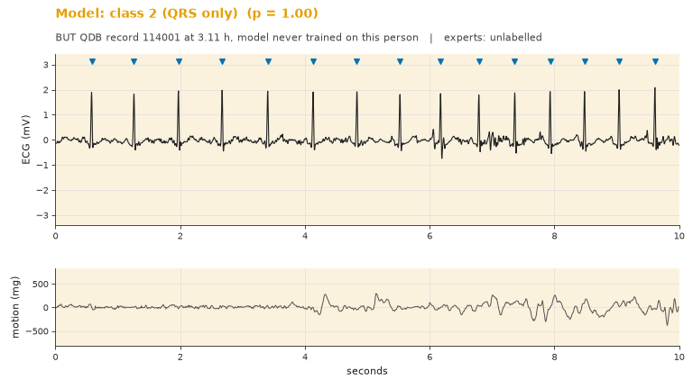
</p>
<p align="center"><em>BUT QDB record 114001, 90 s: the model (trained without this person) moves from "QRS only" to "unusable" as the ECG breaks down, matching the experts.</em></p>

## Results at a glance

| Metric | Baseline | This project | Source |
| --- | --- | --- | --- |
| QRS detection F1, 48 MIT-BIH records (EC57) | 99.55 % (WFDB XQRS library) | **99.58 %** Pan-Tompkins, **99.86 %** Elgendi | `reports/metrics/qrs_mitdb_summary.json` |
| Quality macro-F1, 3 classes, unseen subjects (LOSO) | 0.634 (rule-based SQIs) | **0.771** (gradient boosting, ECG + accelerometer) | `reports/metrics/quality_loso_summary.json` |
| Official BUT QDB test split, sample accuracy | 74.08 % (SNR method, as published) | **87.28 %** | `reports/metrics/quality_fixed_split.json` |
| Pan-Tompkins F1 on ECG with 0 dB motion noise | 0.814 (no gate) | **0.910** with the gate (72 % of beats kept) | `reports/metrics/rejection_nstdb_summary.json` |
| Does the accelerometer help on unseen subjects? | ECG input only | no consistent benefit: +0.019 pooled macro-F1 for gradient boosting (9 of 15 subjects better, p = 0.23); worse for the CNN (10 of 15 subjects worse, p = 0.048) | `reports/metrics/quality_loso_summary.json` |

Quality results use leave-one-subject-out validation over the 15 BUT QDB subjects: no person is ever in both training and test data.

## The problem

ECG from patches and watches in daily life is often too noisy to analyse. Beat detectors then report false beats and rhythm algorithms raise false alarms, which erodes trust in the device. A wearable needs to judge, segment by segment, whether the ECG is good enough for full analysis, good enough only for heart rate, or unusable, and it has to do this for people it was never trained on. Many published quality classifiers split data by random window, so the same person sits in training and test; this project only reports subject-independent numbers.

Research and education only. Not a medical device and not for diagnosis.

## Approach

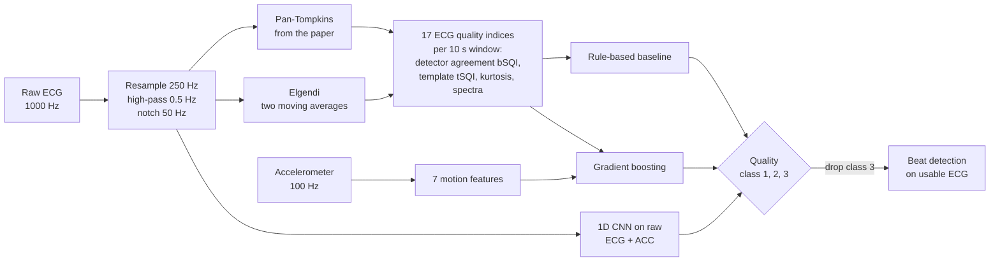

- **Filters**: zero-phase 0.5 Hz high-pass for baseline wander, 50 Hz notch, 40 Hz low-pass, polyphase resampling.
- **Pan-Tompkins** is implemented stage by stage from the paper (integer filters at 200 Hz, derivative, squaring, 150 ms integration, two adaptive thresholds, search-back, T-wave rejection). **Elgendi's two-moving-average detector** is the second, independent detector.
- **Quality indices**: the agreement between the two detectors (bSQI), how alike the beats are (template correlation), kurtosis, skewness, spectral power ratios, heart-rate plausibility and more. All are scale-invariant, so the model also works on MIT-BIH.
- **Classifiers**, in order of complexity: four tuned thresholds, gradient boosting, and a small 1D CNN (about 35k parameters, CPU-trained). Rare classes and long recordings are re-weighted.
- The maths, design choices and worked questions for every part are in [docs/LEARNING.md](docs/LEARNING.md).

## Results

### QRS detection on MIT-BIH

<p align="center">
  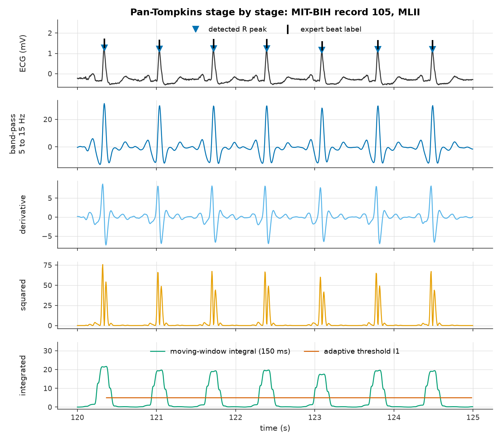
</p>
<p align="center"><em>Every Pan-Tompkins stage on MIT-BIH record 105; detections (triangles) line up with the expert beat labels (bars).</em></p>

<p align="center">
  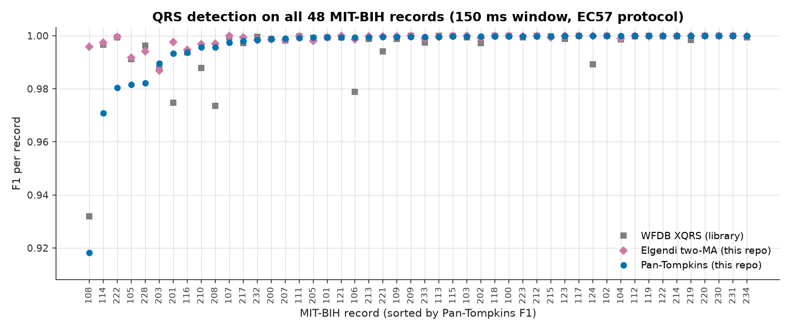
</p>
<p align="center"><em>F1 per record. Overall, both detectors written here score at least the F1 of the WFDB library detector; per record each has its own hard cases, and record 108 (large P waves, noise) is hardest for Pan-Tompkins.</em></p>

| Detector | Protocol | Se | +P | F1 | Timing MAE | Run time, 48 records |
| --- | --- | --- | --- | --- | --- | --- |
| Pan-Tompkins (this repo) | EC57 | 99.68 % | 99.47 % | 99.58 % | 2.7 ms | 30 s |
| Elgendi two-MA (this repo) | EC57 | 99.82 % | 99.89 % | 99.86 % | 4.9 ms | 4 s |
| WFDB XQRS (library baseline) | EC57 | 99.35 % | 99.74 % | 99.55 % | 4.0 ms | 343 s |

150 ms match window, channel 0, ventricular flutter excluded, first 5 min skipped (EC57 learning period). Whole-record and non-paced results: [reports/results_tables.md](reports/results_tables.md). Config: `configs/qrs_mitdb.yaml`.

### Quality classification on unseen subjects (BUT QDB)

<p align="center">
  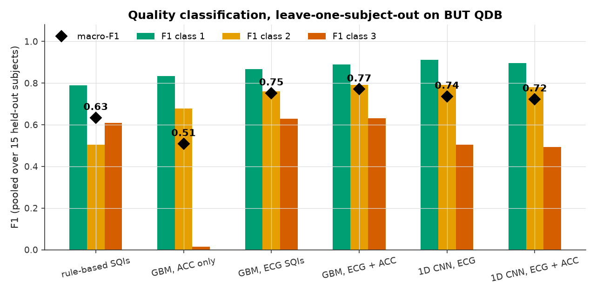
</p>
<p align="center"><em>Pooled F1 over the 15 held-out subjects. Every learned ECG model has a higher macro-F1 than the rule-based baseline, but the CNNs are worse than the rules on class 3 (unusable), which stays the hardest class.</em></p>

<p align="center">
  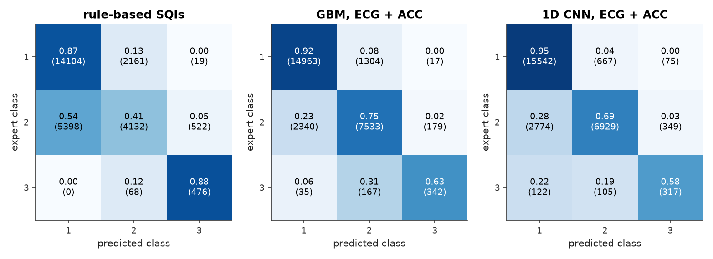
</p>
<p align="center"><em>The rule baseline catches more class 3 (recall 0.88 against 0.63) but calls more than half of class 2 clean; gradient boosting balances the three classes better.</em></p>

<p align="center">
  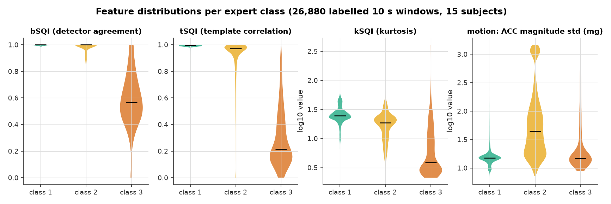
</p>
<p align="center"><em>The ECG indices separate class 3 clearly; motion is highest in class 2, not class 3, which limits what the accelerometer can add.</em></p>

| Model | Macro-F1 (pooled) | Mean subject macro-F1 | F1 class 1 | F1 class 2 | F1 class 3 |
| --- | --- | --- | --- | --- | --- |
| Rule-based SQI thresholds (baseline) | 0.634 | 0.675 | 0.788 | 0.504 | 0.610 |
| Gradient boosting, ACC only | 0.509 | 0.644 | 0.834 | 0.678 | 0.014 |
| Gradient boosting, ECG SQIs | 0.752 | 0.796 | 0.867 | 0.759 | 0.629 |
| **Gradient boosting, ECG + ACC** | **0.771** | 0.819 | 0.890 | 0.791 | **0.632** |
| 1D CNN, ECG | 0.736 | **0.860** | **0.912** | **0.791** | 0.505 |
| 1D CNN, ECG + ACC | 0.723 | 0.816 | 0.895 | 0.781 | 0.493 |

26,880 labelled 10 s windows (16,284 / 10,052 / 544 for classes 1 / 2 / 3) inside the dataset authors' annotated ranges, 15 subjects, leave-one-subject-out. Pooled scores weight every window equally; the mean subject score weights every person equally, which is why the CNN leads one column and gradient boosting the other. Configs: `configs/quality_butqdb.yaml`, seed 0.

**Candidate research question: do accelerometer features help on unseen subjects?**

<p align="center">
  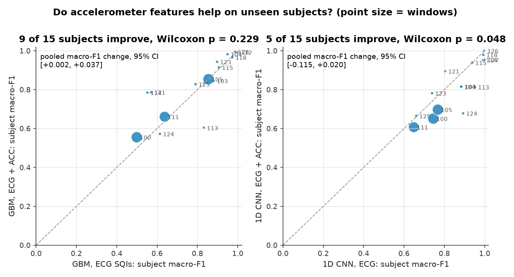
</p>
<p align="center"><em>Each point is one held-out subject. Points above the diagonal improved with accelerometer input.</em></p>

| Comparison | Subjects better / worse | Wilcoxon p | Pooled macro-F1 change, 95 % CI |
| --- | --- | --- | --- |
| Gradient boosting: ECG + ACC features vs ECG only | 9 / 6 of 15 | 0.229 | [+0.002, +0.037] |
| 1D CNN: ECG + raw ACC vs ECG only | 5 / 10 of 15 | 0.048 | [-0.115, +0.020] |

Answer, based on this data: **no consistent benefit**. Hand-made motion features add a small pooled gain to gradient boosting that does not hold for every person, and raw accelerometer channels make the CNN worse for 10 of 15 subjects. In BUT QDB most unusable ECG happens while the person is still (a loose or lifted electrode), so motion is a weak proxy for it. The literature check behind this question is in [docs/RESEARCH_LOG.md](docs/RESEARCH_LOG.md).

### Official split from the dataset authors

| Method | Accuracy | F1 class 1 | F1 class 2 | F1 class 3 |
| --- | --- | --- | --- | --- |
| SNR method (Smital et al.), as published, not re-run | 74.08 % | 83.04 % | 43.39 % | 81.91 % |
| Rule-based SQI thresholds (this repo) | 71.50 % | 81.59 % | 40.47 % | 72.61 % |
| Gradient boosting, ECG SQIs (this repo) | 85.68 % | 89.65 % | 77.61 % | 83.86 % |
| Gradient boosting, ECG + ACC (this repo) | **87.28 %** | **90.65 %** | **81.06 %** | 83.43 % |

11 training records, 7 test records from other subjects, scored per sample inside the authors' annotated ranges, as in their test script.

### Does rejecting class 3 help beat detection?

<p align="center">
  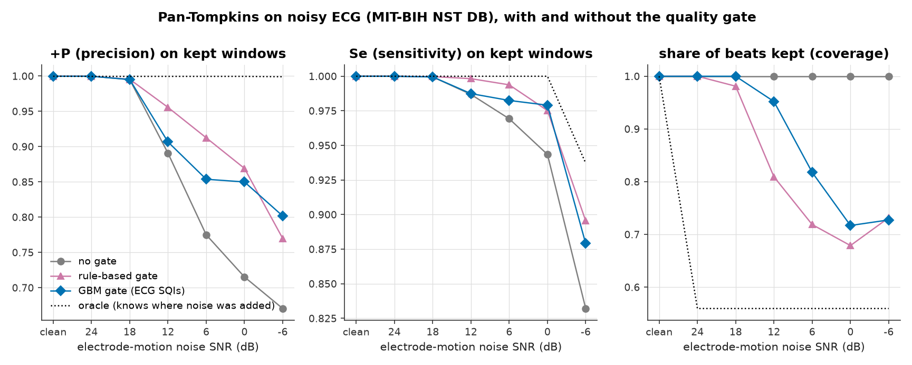
</p>
<p align="center"><em>MIT-BIH noise stress test (records 118 and 119 with electrode-motion noise): both gates lift precision as noise grows. Neither gate drops clean windows down to 0 dB; at -6 dB the GBM gate drops 0.5 % and the rule gate 6 % of them. Models were trained only on BUT QDB.</em></p>

| SNR | No gate F1 | Rule gate F1 (beats kept) | GBM gate F1 (beats kept) | Oracle F1 (beats kept) |
| --- | --- | --- | --- | --- |
| clean | 1.000 | 1.000 (100 %) | 1.000 (100 %) | 1.000 (100 %) |
| 12 dB | 0.936 | 0.977 (81 %) | 0.945 (95 %) | 1.000 (56 %) |
| 6 dB | 0.861 | 0.951 (72 %) | 0.914 (82 %) | 1.000 (56 %) |
| 0 dB | 0.814 | 0.919 (68 %) | 0.910 (72 %) | 1.000 (56 %) |
| -6 dB | 0.743 | 0.828 (73 %) | 0.839 (73 %) | 0.967 (56 %) |

### Failure cases and what they taught

- **Pan-Tompkins search-back bug.** The first full run had 2,875 false positives (+P 97.43 %, kept in `reports/metrics/history/`), worst on records 117 and 119. A false beat in the filters' warm-up made the RR average too short, so search-back picked up T waves. After the fix both records have zero errors ([DECISIONS D2](docs/DECISIONS.md)).
- **A class that looked too easy.** Record 105001 starts with 13 hours labelled class 3 while the device was apparently off the body (flat accelerometer, pure-noise ECG). Including it gave class 3 F1 0.96; following the dataset authors' annotated ranges gives about 0.63, the honest number ([D14](docs/DECISIONS.md)).
- **The CNN confuses arrhythmia with noise.** As a gate on MIT-BIH, the ECG-only CNN rejects every window of record 118, a clean recording with right bundle branch block, a QRS shape never seen in BUT QDB. The feature-based gates do not ([D17](docs/DECISIONS.md)).
- **Motion is not the main cause of unusable ECG here.** Expert class 3 windows have low motion (median close to class 1), so the accelerometer alone almost never finds them (F1 0.01); it helps mainly to tell clean from QRS-only.

<p align="center">
  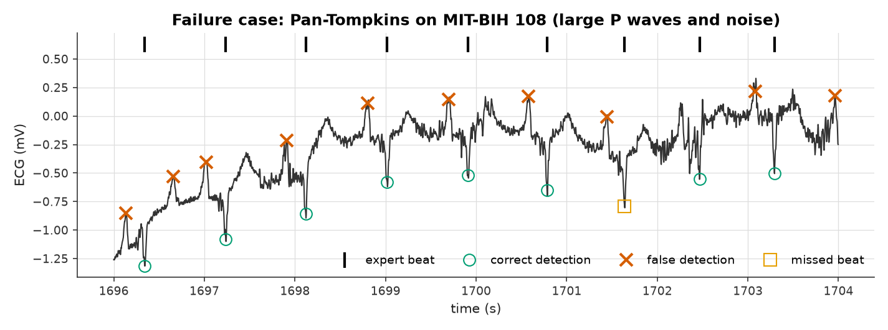
</p>
<p align="center"><em>Remaining Pan-Tompkins failure: on record 108 the tall P waves before each inverted QRS are detected as extra beats.</em></p>

## Demo

<p align="center">
  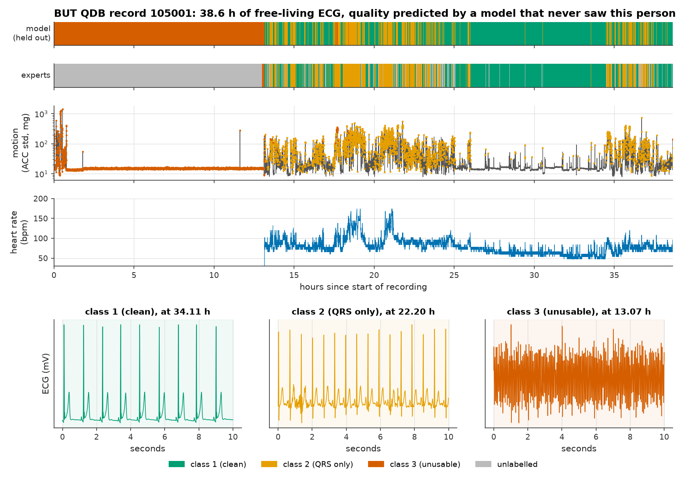
</p>
<p align="center"><em>A day and a half of free-living ECG coloured by predicted quality, next to the experts' labels and the motion recorded by the patch. In the first 13 h the patch was apparently off the body: the model calls it unusable, and the experts' benchmark leaves it out (grey).</em></p>

An interactive explorer shows any recording, its quality timeline, and a zoomable ECG strip with the quality indices and model confidence for each window:

```bash
uv sync --extra app
uv run streamlit run app/streamlit_app.py
```

Deep links work, for example `http://localhost:8501/?record=114001&t=187.5`.

| Recording overview | Zoom into a transition | Quality indices per window |
| --- | --- | --- |
| 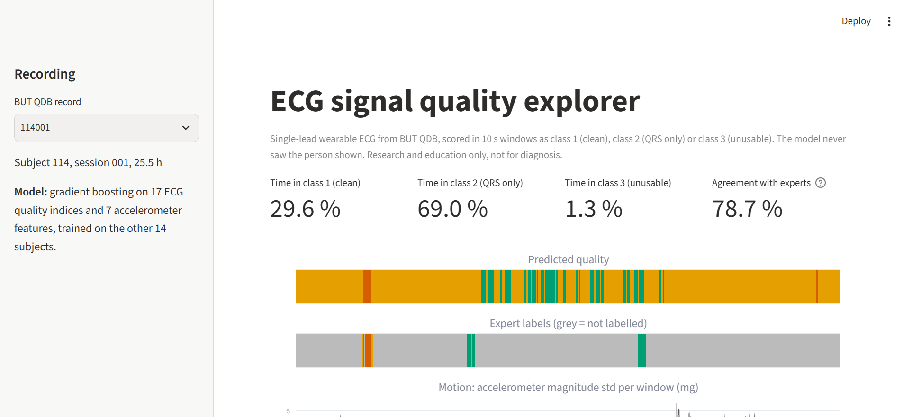 | 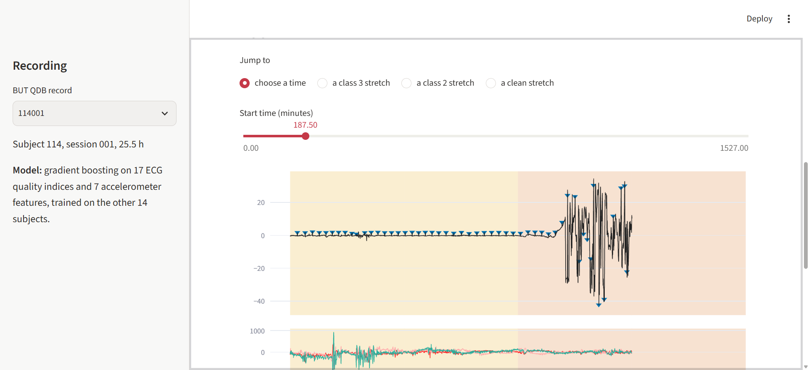 | 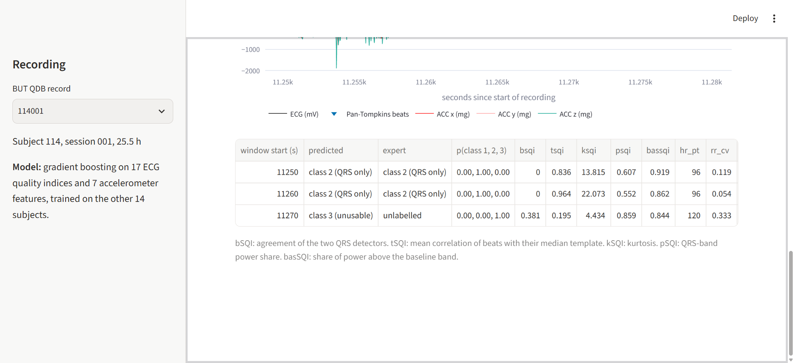 |

A 90 s MP4 of the hero clip is in `assets/demo.mp4`.

## Quickstart

```bash
git clone https://github.com/Adan-Khalid/ecg-quality-beat-detection.git
cd ecg-quality-beat-detection
uv sync                                   # Python 3.12, CPU-only PyTorch, versions from uv.lock
uv run pytest                             # synthetic-ECG tests, no downloads needed

# QRS detectors on MIT-BIH (104 MB)
uv run python scripts/download_data.py --datasets mitdb nstdb
uv run python scripts/evaluate_qrs.py

# Quality classification on BUT QDB (4.2 GB download, about 20 min of feature extraction on 4 cores)
uv run python scripts/download_data.py --datasets butqdb
uv run python scripts/build_features.py
uv run python scripts/evaluate_quality.py          # LOSO, all six models (CNNs take about an hour on CPU)
uv run python scripts/evaluate_fixed_split.py
uv run python scripts/train_final.py
uv run python scripts/evaluate_rejection.py
uv run python scripts/predict_all.py
uv run python scripts/count_windows.py
uv run python scripts/make_figures.py all
uv run python scripts/make_tables.py

# Demo visuals
uv run python scripts/make_demo.py day --record 105001
uv run python scripts/make_demo.py gif --record 114001 --start-window 1124 --seconds 90 --step 0.75
uv run python scripts/make_social_preview.py
```

## Data

| Dataset | Size | Licence | Citation |
| --- | --- | --- | --- |
| [BUT QDB 1.0.0](https://physionet.org/content/butqdb/1.0.0/) | 4.2 GB | CC BY 4.0 | Nemcova et al., PhysioNet 2020, [doi:10.13026/kah4-0w24](https://doi.org/10.13026/kah4-0w24); Smital et al., Sci Data 2026 |
| [MIT-BIH Arrhythmia 1.0.0](https://physionet.org/content/mitdb/1.0.0/) | 104 MB | ODC-By 1.0 | Moody and Mark, IEEE EMB Mag 2001; [doi:10.13026/C2F305](https://doi.org/10.13026/C2F305) |
| [MIT-BIH Noise Stress Test 1.0.0](https://physionet.org/content/nstdb/1.0.0/) | 68 MB | ODC-By 1.0 | Moody, Muldrow and Mark, Computers in Cardiology 1984 |

Raw data is not in this repository. See [data/README.md](data/README.md) and [docs/DATA_CARD.md](docs/DATA_CARD.md) (versions, licences, known issues).

## Limitations and next steps

- **Small and narrow data.** 15 subjects, one patch (Bittium Faros 180), one lead position, one country. Results may not hold for wrist ECG or other populations.
- **Class 3 is rare.** 544 of 26,880 labelled windows, from 7 subjects, so class 3 scores have wide uncertainty. Short unusable episodes inside a mostly clean day are the hardest case: in subject 100 (24 h, 20 class 3 windows) gradient boosting finds 1 of them and the CNN 14 (`reports/metrics/quality_loso_predictions.csv.gz`).
- **Abnormal rhythms.** BUT QDB is mostly sinus rhythm. The CNN rejected a clean bundle branch block recording; any model here should be checked on arrhythmias before use.
- **Offline only.** Zero-phase filters and 10 s windows; not a real-time or embedded implementation.
- **No MATLAB cross-check.** MATLAB was not available; the filters are cross-checked in Python against the paper's equations instead.
- **Next:** tune the CNN on held-out subjects within folds; add arrhythmia examples (MIT-BIH, PhysioNet 2017) to the training data so "unusual" is not confused with "noisy"; test on a wrist device; port the rule gate to fixed-point C for a microcontroller.

## Tool experience summary

- **WFDB (Python)**: reads ECG, accelerometer and annotations, compares beats ([`src/ecgq/io.py`](src/ecgq/io.py), [`tests/test_metrics.py`](tests/test_metrics.py))
- **SciPy**: filter design and Pan-Tompkins stages, Welch spectra, Wilcoxon test ([`src/ecgq/filters.py`](src/ecgq/filters.py), [`src/ecgq/detectors/pan_tompkins.py`](src/ecgq/detectors/pan_tompkins.py), [`tests/test_filters.py`](tests/test_filters.py))
- **NumPy**: vectorised quality indices and the EC57 beat matcher ([`src/ecgq/quality/features.py`](src/ecgq/quality/features.py), [`src/ecgq/metrics.py`](src/ecgq/metrics.py))
- **scikit-learn**: gradient boosting, leave-one-subject-out evaluation ([`src/ecgq/quality/models.py`](src/ecgq/quality/models.py), [`scripts/evaluate_quality.py`](scripts/evaluate_quality.py))
- **PyTorch**: 1D CNN quality classifier trained on CPU ([`src/ecgq/quality/models.py`](src/ecgq/quality/models.py), [`tests/test_quality.py`](tests/test_quality.py))
- **Matplotlib, Streamlit, Plotly**: figures, GIF and the interactive explorer ([`scripts/make_figures.py`](scripts/make_figures.py), [`scripts/make_demo.py`](scripts/make_demo.py), [`app/streamlit_app.py`](app/streamlit_app.py))
- **Git, GitHub Actions, uv, ruff, pytest**: pinned environment, lint and 38 tests on every push ([`.github/workflows/ci.yml`](.github/workflows/ci.yml))

## Repository layout

```
app/        Streamlit explorer
assets/     hero GIF, MP4, screenshots, plot style, social preview
configs/    experiment settings (YAML)
data/       download instructions only
docs/       plan, research log, data card, decisions, experiments, learning notes
reports/    generated metrics, tables, figures and run logs
scripts/    download, build features, evaluate, train, demo, figures, tables
src/ecgq/   filters, detectors, metrics, quality features and models
tests/      unit and end-to-end tests on synthetic ECG
```

## Citation

If this helps your work, please cite the repository (see [CITATION.cff](CITATION.cff)) and the dataset authors listed above.

## Licence

Code: MIT. Datasets keep their own licences (see the Data section).

**Author:** Adan Khalid ([GitHub](https://github.com/Adan-Khalid))
