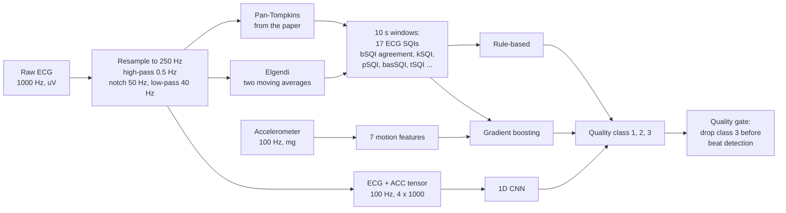

# Project plan

## Problem and users

ECG from wearables in daily life is often too noisy to analyse. Beat detectors then report false beats and rhythm algorithms raise false alarms. A device should first judge whether a stretch of ECG is usable, and for what, before it detects beats or flags rhythms.

Users: developers of wearable ECG firmware and apps (a cheap quality gate before beat detection), analysts reviewing long Holter or patch recordings (bad stretches flagged), and researchers who need a subject-independent benchmark.

## Goals

1. A filtering stage: baseline-wander high-pass and 50 Hz mains notch.
2. Two QRS detectors written from their papers: Pan-Tompkins (1985) and Elgendi's two moving averages (2010, parameters from 2013), validated on MIT-BIH with Se and +P at a 150 ms window and compared with the WFDB XQRS library detector.
3. A classifier that labels each 10 s segment as quality class 1, 2 or 3, built in three steps: rule-based SQI thresholds, gradient boosting on SQIs, a small 1D CNN, each with and without accelerometer input.
4. An honest answer to the candidate research question: do accelerometer features improve quality classification for subjects not seen in training?
5. A measurement of how much beat detection improves when class 3 segments are rejected.
6. A demo: a day-long recording coloured by predicted quality, with the motion that caused the bad stretches.

## Non-goals

- Arrhythmia classification or any diagnosis.
- Real-time embedded code. Everything runs offline in Python.
- Denoising the ECG. The project only decides whether to trust it.
- Beating published BUT QDB numbers that used random window splits (those leak subjects between training and test).

## Pipeline

## Modules

| Module | Responsibility |
| --- | --- |
| `ecgq.filters` | Zero-phase high-pass, notch, low-pass, band-pass; polyphase resampling |
| `ecgq.detectors.pan_tompkins` | Paper filters (FIR form), derivative, squaring, integration, adaptive thresholds, search-back, T-wave rejection |
| `ecgq.detectors.elgendi` | Band-pass 8 to 20 Hz, two moving averages, blocks of interest |
| `ecgq.metrics` | EC57-style one-to-one beat matching, timing error, bSQI, quality report |
| `ecgq.io` | WFDB readers for MIT-BIH, NSTDB and BUT QDB (chunked resampling of 24 h records) |
| `ecgq.quality.features` | SQIs and accelerometer features |
| `ecgq.quality.windows` | Windowing, labels, blockwise detection, CNN tensors |
| `ecgq.quality.models` | Rule classifier, gradient boosting, 1D CNN, class and record weighting |
| `ecgq.quality.inference` | Loading trained models and scoring new recordings |

## Maths (details in LEARNING.md)

- Pan-Tompkins band-pass: H_LP(z) = (1 - z^-6)^2 / (1 - z^-1)^2 and H_HP(z) = z^-16 - (1/32)(1 - z^-32)/(1 - z^-1) at 200 Hz, then y(n) = [2x(n) + x(n-1) - x(n-3) - 2x(n-4)] / 8, squaring and a 30-sample (150 ms) moving average.
- Thresholds: SPKI = 0.125 PEAKI + 0.875 SPKI for signal peaks, NPKI likewise for noise peaks, THRESHOLD I1 = NPKI + 0.25 (SPKI - NPKI), I2 = 0.5 I1.
- bSQI = N_matched / (N_PT + N_EL - N_matched) with a 150 ms tolerance.
- pSQI = P(5 to 15 Hz) / P(5 to 40 Hz); basSQI = 1 - P(0 to 1 Hz) / P(0 to 40 Hz); kSQI = kurtosis.

## Baselines

- Detectors: WFDB XQRS (library) next to the two implementations.
- Quality: rule-based thresholds on bSQI, tSQI and basSQI, fitted on the training subjects of each fold.
- External reference: the SNR method on the official BUT QDB test split (accuracy 74.08 %, from the dataset paper, quoted and not re-run).

## Metrics

- QRS: sensitivity Se = TP / (TP + FN), positive predictivity +P = TP / (TP + FP), F1, timing error, all at a 150 ms window.
- Quality: macro-F1 over the 3 classes (pooled over all held-out subjects, and the mean per subject), per-class F1, confusion matrix. Sample-level accuracy and per-class F1 on the official split.
- Research question: per-subject paired difference with a Wilcoxon signed-rank test, and a subject-level bootstrap 95 % confidence interval of the pooled macro-F1 change.
- Gate: Se, +P and F1 on the windows kept, plus coverage (share of beats kept) at each noise level.

## Split strategy

Leave-one-subject-out over 15 subjects: all records of a subject are held out together. No window, record or subject appears on both sides. Rule thresholds and model weights are fitted only on the training subjects of each fold.

## Acceptance criteria

- Pan-Tompkins Se and +P above 99 % on MIT-BIH (the 1985 paper's abstract reports 99.3 % of QRS complexes detected).
- Unit tests for every filter and detector stage, and a CI run on synthetic data.
- Every number in the README read from a file in `reports/`.
- The research question answered with a test and an interval, whichever way it falls.

## Risks

| Risk | Mitigation |
| --- | --- |
| Few class 3 windows, so class 3 F1 is unstable | Class weights; report per-class F1 and per-subject results; confidence intervals |
| Three long records dominate | Per-record weights in training; per-subject metrics |
| Domain shift from BUT QDB to MIT-BIH in the gate test | Scale-invariant features only; transfer reported as a finding, not hidden |
| No GPU on this laptop | Small CNN (about 45k parameters), 10 s windows at 100 Hz, CPU training |
| Download of 4.2 GB over a slow link | Resumable, checksum-verified download script |
